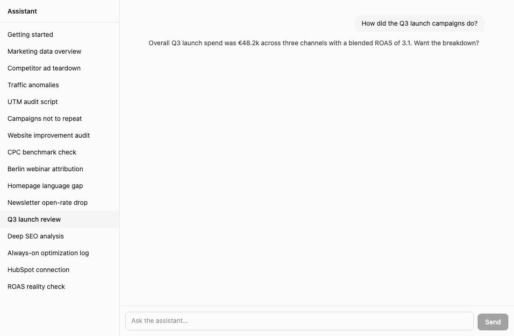

# Streaming Agent Console

[](https://github.com/Nicola-Rizzi/streaming-agent-console/actions/workflows/ci.yml)

A chat interface for an AI assistant that shows its work. While it answers, you can see what it's thinking, which tools it uses, which specialists it hands work to, and the charts and files it produces, all as they arrive.

It's built for the moments when things go wrong. Whether you stop a turn, it fails, it goes quiet or the connection drops, the screen always tells you clearly what happened.



There's no real assistant behind it: a small mock backend replays recorded conversations. The companies, people and numbers in them are made up.

## What it does

- **Streams answers as they're written**, without half-finished formatting flickering on screen.
- **Shows the work without getting in the way.** Reasoning and tool calls are smaller and grey, grouped in one box, with the details a click away.
- **Nests specialists** under the step that called them, however deep they go.
- **Asks you questions** with a small form when it needs your input, and waits for the answer.
- **Is honest about failure.** Stop, errors, dropped connections and silences each look different, and an interrupted answer can be resumed.
- **Copes with the unexpected.** Content it doesn't recognise shows a short note instead of breaking the page.
- **Works with a keyboard and a screen reader**, and passes an automated accessibility check (WCAG 2.1 AA).

## Try it

You need Node 22.

```sh
git clone https://github.com/Nicola-Rizzi/streaming-agent-console.git
cd streaming-agent-console

# terminal 1: the mock backend
cd server && npm install && npm start     # http://localhost:8787

# terminal 2: the app, from the repository root
npm install
npm run dev                               # http://localhost:5173
```

Open the app, pick a conversation on the left and send a message.

| Command | What it does |
|---|---|
| `npm test` | 66 unit tests, in a few seconds |
| `npm run test:e2e` | 10 end-to-end tests in a real browser, in about 90 seconds (downloads Chromium the first time) |
| `npm run demo:gif` | Records the GIF above again, from the real app |

## What's where

```
app/        the React app and its tests
server/     the mock backend
fixtures/   the recorded conversations it replays
docs/       the demo GIF
.github/    the automatic checks
```

## How it works

```
 mock backend ──stream──▶ session ──▶ decode ──▶ reducer ──▶ selectors ──▶ screen
                             ▲                                                │
                             └──────── send, Stop, Resume, answers ◀──────────┘
```

- **`session.ts`** looks after the connection: one stream at a time, Stop, noticing when the stream goes silent, and resuming.
- **`decode.ts`** turns what arrives into typed messages. It never crashes: anything broken or unknown becomes a short note, and keep-alive pings are ignored.
- **`reducer.ts`** keeps every message once, in a flat list.
- **`selectors.ts`** builds what you see (turns, groups, nested specialists) from that list, so the screen always matches the data.

None of this depends on React, so most of it is tested as plain functions.

Three details that matter:

- Messages usually arrive twice: in pieces while they're written, then complete. The complete version always wins, so replaying a conversation never shows anything twice.
- Reopening a conversation rebuilds it out of sight and swaps it in when it's ready, so nothing flickers.
- While text streams, only the part that changed is redrawn.

## How an answer can end

| What happens | What you see |
|---|---|
| The assistant finishes | **Done**, and how long it took |
| You press Stop | **Stopped**, keeping everything that arrived |
| An error, then the assistant carries on | The error, in place, and the answer continues |
| An error, then the stream ends | **Failed** |
| The connection drops | **Interrupted**, with a Resume button |
| 15 seconds of total silence | **Reconnecting**, up to 4 times, then Interrupted |

## Design choices

- The answer comes first, in full contrast. The work behind it is there but quiet.
- Colour only ever means a state (ok, warning, error), and each state also has a symbol and a word.
- One line per answer says what the assistant is doing and for how long. The browser tab says "Working…" or "Question for you" if you've switched away.
- The page follows new content while you're at the bottom. Scroll up to read and it stays put; a button takes you back down.
- While a question is waiting, the message box is locked and says why.

## Tests

- **Unit tests** check each rule on its own: reading the stream, decoding, streaming text, specialists, every way an answer can end, the connection logic, the main components, and what a screen reader hears.
- **End-to-end tests** run the real app in a real browser against the mock backend: a full answer with a question, Stop, a dropped connection, errors, a silence, formatting, unknown content, an old-format conversation and scrolling. They fail on any unexpected error in the browser console, and one checks accessibility with [axe](https://github.com/dequelabs/axe-core).
- **GitHub** runs the type check, the formatting check and both kinds of test on every push.

## Known limits and next steps

- A stopped answer only shows as stopped until you leave the conversation, because the history doesn't record stops.
- Very long conversations would benefit from rendering only what's on screen.
- Charts show a labelled placeholder. Real charts need a charting library, loaded only when needed.
- Resuming replays the whole conversation. The backend could send only what was missed.
- A failed answer can't be retried with one click yet.
